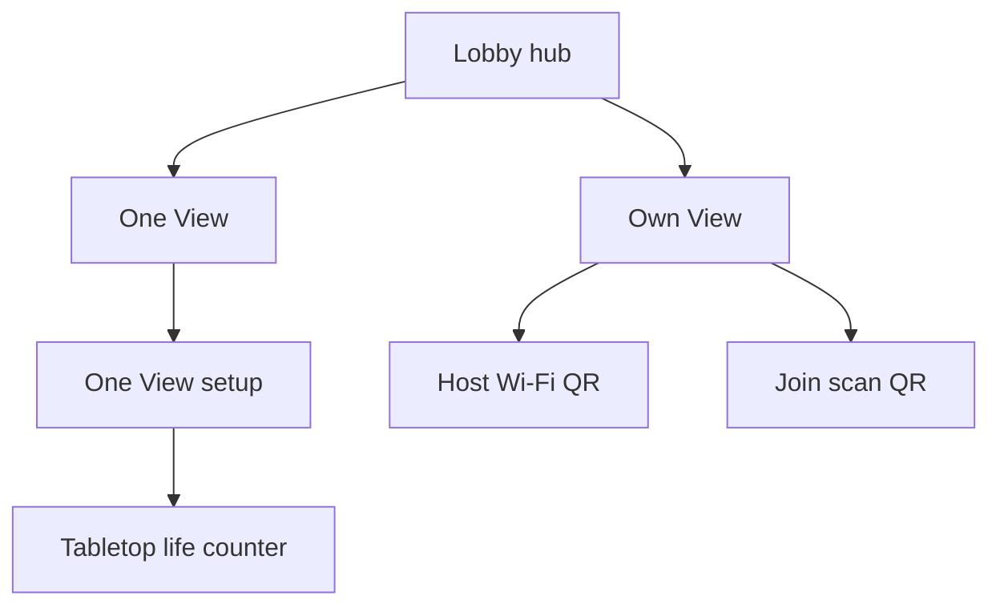

# One View / Own View Lobby Plan

Status: **decisions locked**. Ready to build when we say go.

Lobby hub becomes **One View** + **Own View**. Own View keeps today’s Host/Join unchanged. New work is **One View only**: setup, rotated tabletop, claimable seats with deck pick (Sit as me / QR / Guest), and mid-game settings.

## What One View means

**Setup screen first:**

- Players: 1–6
- Layout follows player count (see seat maps below)
- Starting life chips (20 / 25 / 30 / 40 / 60 + custom)
- Gameplay toggles: Planechase, Archenemy, Bounty, Auto-KO, commander-damage life loss, turn timer

**Then the table screen:**

- Phone sits in the middle of the table
- All players on this one screen
- One seat per player with large life total and +/-
- Opposite seats rotated 180° so each person can read their own seat
- Center strip for shared tools: reset, player count, menu, dice / colors
- Names on seats; art behind each seat when available
- Not the current per-phone Play hub; a true shared table view

## Hub naming

The split is not “alone vs with people.” Both modes are for playing with people.

- **One phone** — phone sits in the middle of the table; everyone uses this device
- **Separate phones** — each player uses their own phone; today’s Host / Join Wi‑Fi

Do not use: Offline, Online, Local, Multiplayer, Solo.

| Button | Mode | Subtitle idea |
| --- | --- | --- |
| **One View** | One shared phone | Everyone shares this phone |
| **Own View** | Separate phones | Each player uses their own phone |

**Own View:** keep today’s Host / Join exactly as it works now. Hub only renames/rehomes the entry point.

**Build focus:** new work is One View only (setup + tabletop).

## Locked decisions

- Hub: **One View** | **Own View**
- Own View: current Host / Join, unchanged
- New work: One View only — hub + setup + real rotated tabletop
- Seats: Sit as me + QR profile + Guest, then deck pick (Guests skip deck)
- Mid-game: settings still changeable from the center menu

## Locked refinements

1. **Sit after Start** — setup is rules-only; claim seats on the table after Start; empty seats until claimed.
2. **Empty seats OK** — start with N seats; sit mid-game; Guests allowed.
3. **Deck pick during seating** — after Sit as me or QR, pick a deck so deck/commander stats record like today; seat shows player + deck art. **Guests skip deck pick.**
4. **QR sit code** — player id, username, avatar; deck picked on the One View phone after claim; no Wi‑Fi game session in the QR.
5. **XP in v1** — match saved on this phone with names, ids, decks; no XP push to other phones yet; Sit as me updates this phone’s profile/deck as today.
6. **Layouts** — 1–6 seat maps as locked below; 2 = top/bottom halves; 4 = 2×2.
7. **Build order** — hub → setup + table life → Sit as me / Guest + deck → QR + deck → mid-game settings.
8. **Visual style** — Life Spark look, inspired by references, not a pixel copy.

## Extra refinements (locked)

1. **Guest decks** — Guests do **not** pick a deck. Name only; no deck/commander stats for that seat.
2. **One profile, one seat** — the same Sit as me / QR profile cannot sit in two seats.
3. **Phone orientation** — One View table prefers **landscape**.
4. **Keep screen on** — while the One View table is open, keep the display awake.
5. **Seat tools in v1** — life +/- first; poison + commander damage from the seat (tap / long-press), not a full Own View HUD clone.
6. **Friend sit QR** — “Show sit code” on the friend’s Profile; separate from Own View Host QR.
7. **Mid-game player count** — adding seats adds empty seats; removing a filled seat asks to confirm; remaining life totals stay.
8. **End game** — reuse current leave/end flow; record seated players + decks on this phone.

## Seat maps (locked, landscape)

Player count picks the split. Opposite seats rotate 180° where they face the far edge.

1. **1 player** — full screen, one seat
2. **2 players** — screen split **in half vertically** (top / bottom). Top seat rotated 180°.
3. **3 players** — one seat on one half, two seats on the other (common life-counter 3-up)
4. **4 players** — 2×2 grid
5. **5 players** — workable 5-up grid (one larger edge seat or 2+3), polish later if needed
6. **6 players** — 2×3 grid

v1 ships all 1–6 as usable maps; 4 is the showcase layout.

## Build phases

### Phase 1 — Lobby hub

- Change `lib/features/game_lobby/game_lobby_screen.dart` to **One View** | **Own View**
- Own View opens the existing Host / Join flow with no behavior change
- English strings only in `lib/l10n/app_en.arb`

### Phase 2 — One View setup

- New setup screen inspired by life-counter settings references, Life Spark styling
- Players 1–6 (layout from seat maps), starting life chips + custom
- Reuse existing `LobbyConfig` toggles: Planechase, Archenemy, Bounty, Auto-KO, commander-damage life loss, turn timer
- Start seeds local seats only (no `WsHostService`, no QR)

### Phase 3 — One View tabletop UI

- New single-device table view for One View only
- Own View keeps the current networked game screen
- Rotated seats, large life, +/- , center tools
- Claimable seats: empty seat → Guest / Sit as me / Load profile via QR → pick deck (Guests skip deck)
- Reuse existing deck picker patterns from lobby deck pick / `applyDeck`
- Game rules stay in `game_state_notifier.dart`; this is mostly a new view plus seat identity + deck wiring
- Match recording: seat identities and decks go into the match record on this device; full cross-phone XP sync can follow later

## Out of scope

- Changing Host / Join / Own View gameplay
- Real internet / cloud multiplayer
- Pixel-perfect clone of competitor apps
- Profile / Decks / Collection redesign outside sit-code needs
- Hive deck migration fix (separate local crash fix)

## Implementation todos

- [ ] Lobby hub shows One View | Own View; Own View opens existing Host/Join with no behavior change
- [ ] Add One View setup screen (players, layout, life, LobbyConfig toggles) and local seat bootstrap without Wi-Fi
- [ ] Add rotated tabletop with claimable seats, deck pick, life controls, and mid-game settings
- [ ] Add Sit as me / Guest / QR sit-code claiming and deck picker on seat claim
- [ ] Add English One View / Own View strings and update router for the hub + One View routes
